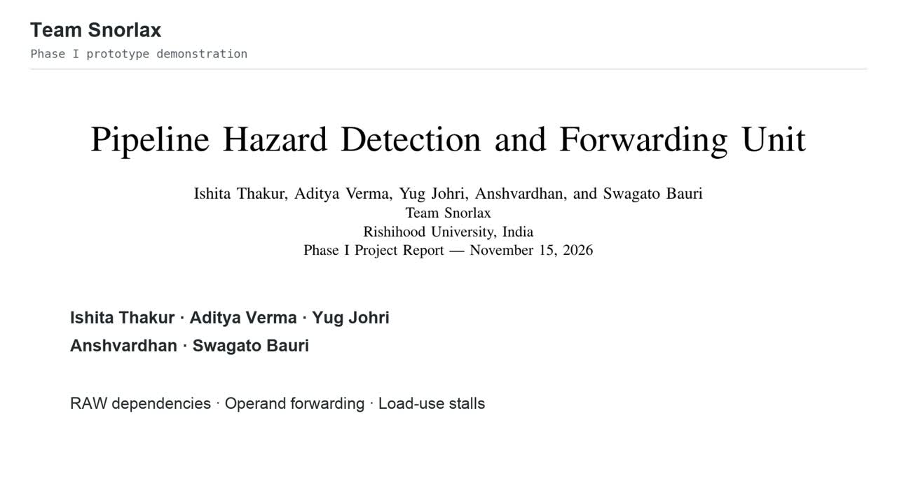

# Pipeline Hazard Detection and Forwarding Unit

Team Snorlax — Ishita Thakur, Aditya Verma, Yug Johri, Anshvardhan, and Swagato Bauri.

Verilog hazard detection and operand forwarding for a five-stage IF/ID/EX/MEM/WB pipeline. The design handles RAW dependencies using EX/MEM and MEM/WB forwarding, with an interlock for load-use hazards.

## Report and demonstration

- [IEEE project report](docs/phase1/ieee-report.pdf) · [LaTeX source](docs/phase1/ieee-report.tex)
- [Prototype demonstration — 4:51 (MP4)](docs/media/prototype-demo.mp4) · [Direct video download](https://raw.githubusercontent.com/Mystic-commits/pipeline-hazard-unit/main/docs/media/prototype-demo.mp4) · [Chapters](docs/phase1/video.md)
- [Team responsibilities and contributing](contribution.md)

[](https://raw.githubusercontent.com/Mystic-commits/pipeline-hazard-unit/main/docs/media/prototype-demo.mp4)

## Build and verify

Prerequisites: Icarus Verilog (`iverilog` and `vvp`), Python 3, and Make.

```sh
make verify      # All tests, seeded regression, and waveform checks
make wave        # Generate build/pipeline.vcd for GTKWave
```

`make test` runs the core suite; `make regression` runs additional seeds. To rebuild the report with Tectonic, run `make report`.

## Presentation demo

Run these commands in order from the repository root (the folder containing `Makefile`). If you have already cloned the project, open that folder in your terminal. For a new checkout:

```sh
git clone https://github.com/Mystic-commits/pipeline-hazard-unit.git
cd pipeline-hazard-unit
```

### 1. Compare correct execution with and without forwarding

```sh
make integration
cat build/results.csv
```

Expected simulation output:

```text
PASS pipeline: forwarding cycles=15 stalls=1; stall-only cycles=26 stalls=12
```

Both protected modes must match the sequential reference. Explain that forwarding removes avoidable waits while retaining one required load-use stall.

### 2. Generate and check the waveform

```sh
make wave
python3 scripts/check_waveform.py
cat build/waveform-cases.csv
```

The audit should print five `PASS waveform` lines. Point out these stable samples:

| `time_ps` | Time | What to explain |
|---:|---:|---|
| 100000 | 100 ns | `stall=1`, `pc=8`: the load-use dependency requests a hold. |
| 110000 | 110 ns | `ev=0`, `pc=8`: the bubble and held PC show the previous stall's effect. |
| 120000 | 120 ns | `fa=1`, `a=103`: the consumer resumes with loaded data from MEM/WB. |

If GTKWave is installed, open the waveform graphically:

```sh
gtkwave build/pipeline.vcd
```

Expand `tb_pipeline.fast` and inspect `pc`, `ev`, `stall`, `fa`, `a`, and `result` around 90–130 ns. GTKWave is optional; the CSV contains samples from the actual VCD.

### 3. Show the hazard and stall-control code

```sh
cat rtl/hazard_detection.v
cat rtl/stall_control.v
```

Explain the condition `ex_load && (e1 || e2)`, then the three outputs: hold PC, hold IF/ID, and invalidate the next EX slot. Older stages continue so the load can finish.

### 4. Run additional checks if asked

| Command | Demonstration |
|---|---|
| `make edges` | Nine edge cases, including deliberately incorrect execution with protection disabled. |
| `cat build/edge-results.csv` | Results of those cases; case 8 records an incorrect-mode register mismatch. |
| `make reset` | Reset during a load-use hazard and clean restart. |
| `make random ARGS='+seed=42'` | Repeat a deterministic set of randomized programs. |
| `make verify` | Complete suite, all four recorded seeds, waveform generation and audit. |

`make verify` includes the integration and waveform checks above, so use it instead of repeating every target when a full run is requested. A failure or `$fatal` is not a successful demonstration; inspect the first error. Saved results under `docs/evidence/` are available for comparison with fresh outputs under `build/`.

## Results

| Mode | Instructions | Cycles | Stalls | CPI |
|---|---:|---:|---:|---:|
| Forwarding with load-use interlock | 10 | 15 | 1 | 1.500 |
| Stall-only interlocks | 10 | 26 | 12 | 2.600 |

Both modes match the sequential reference. Verification includes 4,194,304 unit combinations, nine edge cases, reset/restart, 400 seeded programs, and five waveform checks. Measurements apply to the supplied simulation workload.

## Project files

| Path | Contents |
|---|---|
| `rtl/` | Comparators, forwarding unit, operand mux, hazard detection, stall control, and pipeline harness |
| `tb/` | Unit, integration, randomized, edge-case, and reset testbenches |
| `scripts/` | VCD audit and waveform sample export |
| `docs/evidence/` | Captured VCD, results, and verification log |
| `docs/phase1/` | IEEE report, editable source, and video chapters |
| `docs/media/` | Narrated prototype demonstration |

See the [architecture](docs/architecture.md), [verification guide](docs/verification.md), and [performance analysis](docs/report.md).

The harness supports decoded ADD, SUB, and LW operations with word-indexed memory. A binary ISA decoder, branches, stores, caches, and variable-latency memory are outside its scope. MODE=2 deliberately disables protection to demonstrate incorrect RAW execution; MODE=1 is the intended forwarding design.
