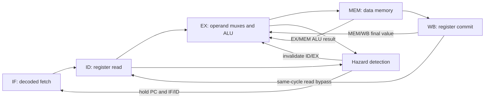

# Architecture and integration contract

Stages: IF fetches decoded records; ID reads registers; EX runs ADD/SUB or calculates a load address; MEM reads data memory; WB commits. Each stage carries a valid bit so bubbles cannot write registers or retire.

## Forward selection

| Selector | Operand source |
|---|---|
| 00 | ID/EX captured register value |
| 01 | MEM/WB writeback value (ALU result or loaded data) |
| 10 | EX/MEM ALU result |

A source matches only when it is used, the producer writes, and the destination is nonzero. EX/MEM wins over MEM/WB. A matching EX/MEM load suppresses the older WB match, but cannot supply its address as data. Correct integration stalls the dependent consumer before it reaches EX.

## Load-use interlock

When ID consumes the nonzero destination of a load in EX, hold PC and IF/ID, invalidate ID/EX, and let MEM/WB advance. After one cycle the consumer enters EX, where the load's MEM/WB value is available. LW consumes rs1, not rs2. ADD and SUB consume both sources. Decode must supply accurate source-use and write-enable flags.

## Baseline

The stall-only mode interlocks on dependencies in EX and MEM. Explicit WB-to-ID bypass allows a consumer to read a value in the same cycle WB writes it. Thus a dependent ALU instruction requires two bubbles without forwarding. Both modes are functionally correct; a pipeline with all hazard handling disabled is not a valid CPI competitor because its answers can be wrong.

## Timing and boundaries

Reset is synchronous and active high. The demo initializes register rN to N, r0 to zero; this is a test fixture convention. Memories and decoded program arrays are supplied by the testbench. Loads use word indices; low eight address bits select one of 256 words. No byte addressing, alignment exceptions, branch flushes, stores, multi-cycle memory or complete ISA is claimed. The standalone combinational units are synthesizable; the demo's initialized arrays and internal testbench access are for simulation integration.

For a real core, gate producer write signals with valid bits and supply the selected load/ALU WB result to the forwarding mux. Add independent control-hazard and memory-backpressure handling before extending the instruction set.

## Unprotected demonstration mode

MODE=0 selects stall-only interlocks; MODE=1 selects forwarding plus load-use interlocks. MODE=2 disables both and deliberately allows RAW failures. Use MODE=1 for the intended design. N must be at least one. Invalid stage metadata is cleared before memory/writeback evaluation; architectural effects remain controlled by valid bits.

